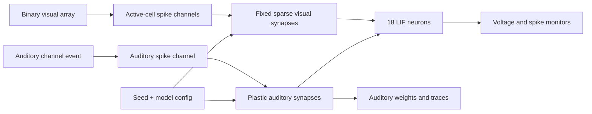

# Multisensory Dynamics Lab

MDL is a small CPU-first neural architecture research core. It currently contains one Brian2 model: a fixed sparse visual projection and a plastic auditory projection converging on an 18-neuron LIF population.

## Architecture



Default input dimensions are 25 visual channels from a binary 5×5 array and three auditory channels. Each active visual cell produces one event. An auditory event is a channel index and event time; waveforms, token meanings, and target labels are not supplied to the network. Visual connectivity is sampled once from the configured seed and remains fixed. Auditory connectivity is dense and plastic.

## Neural dynamics

Each associative neuron follows

```text
dv/dt = (-70 mV - v) / 10 ms
threshold: v > -50 mV
reset: v = -70 mV
refractory: 5 ms
```

The default numerical step is 0.1 ms, matching Brian2's former default. Visual spikes add a fixed 12 mV at connected neurons. Auditory spikes add `w × 60 mV`. Pair-based STDP uses 20 ms event traces, pre increment `+0.01`, post increment `-0.012`, and weight clipping to `[0, 1]`. A shared gate disables or enables these updates. The equations and defaults are in `src/mdl/plasticity.py` and `src/mdl/config.py`.

Persistent neural state includes membrane voltages, auditory synaptic weights and traces, simulation time, and Brian2 event state. `mdl.state` saves a Brian2 continuation checkpoint plus an architecture/configuration manifest; restoration rejects a mismatched configuration. `run_event` returns voltage samples, spike events, and response summaries. The network has no output/decision population: any classifier or candidate choice belongs to an explicitly external experiment readout.

## Run

Install the pinned runtime and test dependency:

```powershell
python -m pip install -e ".[dev]"
```

Present auditory channel 1 and visual cells 2, 7, and 12 for 60 ms of biological time:

```powershell
python -m mdl.run --seed 42 --cue 1 --visual-cells 2,7,12 --duration 0.060 --state-out state.b2
```

Continue from a compatible checkpoint with plasticity disabled:

```powershell
python -m mdl.run --seed 42 --cue 1 --no-plasticity --state-in state.b2
```

Run the fast neural-core tests:

```powershell
python -m pytest
```

The reference fixture `tests/reference/distributed_seed123.npz` was captured from the backed-up distributed implementation (seed 123, visual cells 2/7/12/17/22 with auditory channel 1, 60 ms paired event, 20 ms rest, then a frozen auditory event). The regression test requires exact visual edges and event indices/times, voltage within `1e-9 mV`, and weights within `1e-12`; these tolerances preserve numerical behavior without requiring byte-identical checkpoint files.

## Current limits

This is a sensory-to-population dynamical substrate, not a complete prediction or recognition system. It has no recurrence, learned visual pathway, output head, semantic audio decoding, action loop, structural plasticity, GUI, or evidence of robust generalization. Prior experiment reports and implementations are retained in Git history rather than shipped as active code.
