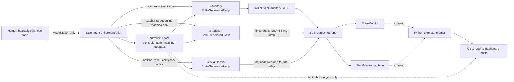
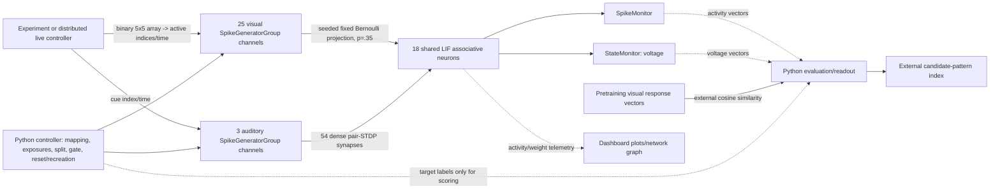

# End-to-end information flow

The diagrams show implemented paths. Dashed boxes are external Python operations. The task controller retains cue/target labels for scheduling, training and scoring; only spike indices/times enter the Brian2 groups.

## Three-output association circuits

The tone generated by `sensory_environment.audible_cue` is a deterministic 440/554.37/659.25 Hz sinusoid for display/playback. The model is given one of three auditory spike channels, not that waveform (`network.py:80-109`, `sensory_environment.py:22-36`).

## Distributed 5×5 association

There is no text path. No speech recognition, phoneme/token pathway, RGB or 2D visual encoder, recurrent edge, action neuron, or neural winner circuit is present.

## External computation that can be mistaken for neural capability

| Computation | Location | In-network? | What the code does |
|---|---|---|---|
| Binary array → active visual channel indices | `stimuli.py:16-22`; `distributed_network.py:90-99` | No; deterministic adapter | Emits one spike per active cell. |
| Audio tone production | `sensory_environment.py:22-36`, `audio_player.py:10-46` | No | Converts cue ID into a tone for the person; neural input remains a channel event. |
| Cue/target permutation and schedule | `stimuli.py:52-62`, experiment/controller modules | No | Selects labels, paired exposures, trial order, timing and condition. |
| Association choice | `assessment.py:7-22`; other experiment `_recall` functions | No | Argmax over spikes or voltage-derived peak. Ties are handled differently by different runners. |
| Distributed “recognition” | `distributed_visual_experiment.py:56-108` | No | Cosine similarity between activity vector and fixed visual reference vectors. |
| Motion direction / next position | `action_pilot.py:55-206`; `temporal_memory_pilot.py:112-210` | No | Nearest-centroid direction readout and fixed Python candidate rules. |
| Action-inspired objective | `action_pilot.py:126-139` | No | Scores discrete candidate steps using the history classifier output and training speed estimate. |
| Memory accuracy / response separation | experiment scripts | No | Uses train-fitted Python centroids and held-out labels. |
| Dashboard neural graph and plots | `live_dashboard.py`, `distributed_live_dashboard.py` | No | Reads voltage, weights and monitor events; display does not alter neural dynamics. |

Targets are not directly presented to the processor during frozen recall; teaching targets are delivered through the dedicated fixed teacher path in configurations that use it. In the distributed association experiment, visual pattern arrays are input sensory data, but the pattern identity, cue mapping, and correctness remain in Python for scheduling and evaluation. The external readouts should be named whenever reporting system-level accuracy.
